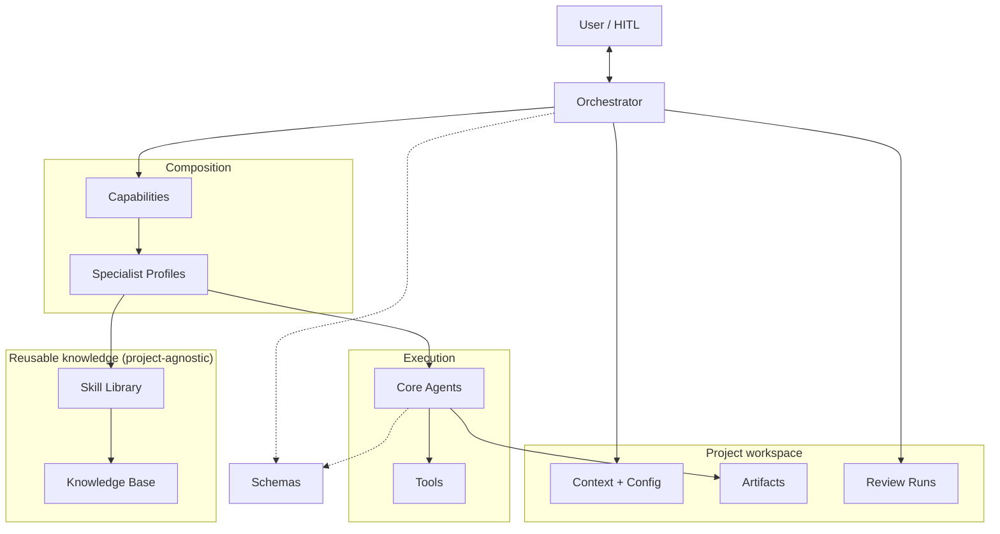
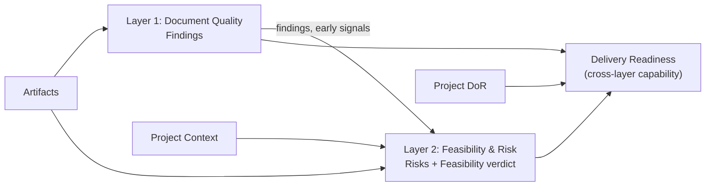
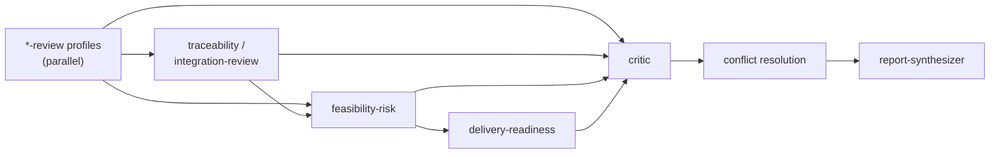

# ARCHITECTURE

Version: `0.1.0` · Trạng thái: Approved (Architecture Proposal v3)

Tài liệu này mô tả kiến trúc logic, ranh giới thành phần, luồng dữ liệu và ánh xạ sang hiện thực vật lý. Lý do của từng quyết định nằm trong [`adr/`](adr/).

---

## 1. Logical Architecture

### 1.1 Trách nhiệm và quyền sở hữu dữ liệu

| Thành phần | Trách nhiệm | Sở hữu | Không làm |
|---|---|---|---|
| Orchestrator | Task understanding, planning, routing, dependency, conflict protocol, consolidation | task, execution-plan, conflict-record, run-manifest | Không chứa tri thức chuyên môn; không tự phán đoán chuyên môn |
| Capability | Ghép Profiles, aggregation/verdict rules, domain-agnostic consistency rules | CAPABILITY.md, consistency-rules | Không chứa tri thức chuyên môn |
| Core Agent | Thực thi theo kiểu suy luận | review-result của assignment | Không tự chọn Skill; không vượt scope |
| Profile | Cấu hình vai trò | profile definition | Không chứa tri thức |
| Skill | Tri thức chuẩn hóa | procedure, criteria, rules, checklist | Không chứa dữ liệu dự án; không có state |
| Knowledge Base | Nguồn gốc | source registry, research notes | Không chứa dữ liệu dự án |
| Schemas | Data contracts | JSON Schemas | Không chứa logic nghiệp vụ |
| Tools | Năng lực vận hành | raw parsed data, validation results | Không đưa phán quyết chuyên môn |
| Project | Dữ liệu đặc thù | context, config, artifacts, runs | — |

### 1.2 Routing chain — một nơi định nghĩa cho mỗi ánh xạ

| Ánh xạ | Nơi định nghĩa |
|---|---|
| Task type → Capability | `orchestrator/routing-rules.md` |
| Capability → Profiles, phases, rules | `capabilities/<cap>/` |
| Profile → Core Agent + Skills | `agents/profiles/<profile>.md` |
| Skill → Criteria / Rules | `skills/<domain>/<skill>/criteria.yaml`, `rules.yaml` |
| Skill → Skill | `depends_on` trong `SKILL.md` |
| Criterion/Rule → Source | `source_refs` → `knowledge/source-registry.yaml` |

### 1.3 Dependency direction

- `projects/*` phụ thuộc Core; Core **không bao giờ** phụ thuộc một dự án cụ thể.
- Profile tham chiếu Skill; Skill không biết Profile nào dùng nó.
- Skill trích dẫn Knowledge Base; Knowledge Base không biết Skill nào dùng nó.

## 2. Hai Assessment Layers

## 3. Agent Architecture

### 3.1 Core Agents

| Core Agent | Kiểu suy luận | Output |
|---|---|---|
| [`artifact-reviewer`](../agents/core/artifact-reviewer.md) | So một artifact với criteria | finding[] |
| [`cross-artifact-analyzer`](../agents/core/cross-artifact-analyzer.md) | Phân tích quan hệ/nhất quán giữa artifacts | finding[] |
| [`solution-assessor`](../agents/core/solution-assessor.md) | Phán đoán dưới ràng buộc và bất định | risk[], feasibility-assessment, delivery-readiness |
| [`critic`](../agents/core/critic.md) | Kiểm chứng độc lập | critic-validation[] |
| [`report-synthesizer`](../agents/core/report-synthesizer.md) | Tổng hợp, trình bày | final-report |

### 3.2 Profile Execution Isolation

- 1 Assignment = 1 Profile (bắt buộc). Có thể chia 1 Profile thành nhiều Assignment; **không** gộp nhiều Profile.
- Assignment không phụ thuộc nhau → chạy song song.
- Critic luôn ở Assignment tách biệt với producer của output được kiểm chứng.
- Isolation ở mức **execution context**, không phải process.

## 4. Workflow

Xem [`orchestrator/workflow.md`](../orchestrator/workflow.md). Chuỗi phụ thuộc điển hình:

## 5. Data Contracts

Xem [`schemas/README.md`](../schemas/README.md).

## 6. Reproducibility

Mỗi run ghi `run-manifest.yaml` (schema: `review-run-manifest.schema.json`). Các trường được phân loại bắt buộc / tùy chọn / không thể thu thập, dùng `CapturedValue`. Hệ thống **không cam kết** output giống hệt khi chạy lại.

## 7. Logical vs Physical Implementation

| Thành phần logic | Hiện thực vật lý khuyến nghị (giai đoạn đầu) |
|---|---|
| Orchestrator | Instruction set được nạp vào phiên điều phối chính của một AI agent runtime |
| Core Agent | Instruction template (Markdown) |
| Profile, Capability, Skill, KB | File Markdown/YAML, nạp có chọn lọc |
| Assignment | Một lần gọi có context riêng (subagent / phiên riêng / LLM call riêng), có thể cùng process |
| Tools | Năng lực của nền tảng hoặc script nhỏ (tương lai) |
| Schemas | File JSON Schema để validate output |
| Review Run | Thư mục file output |

**Runtime Adapter** (tương lai) ánh xạ kiến trúc logic sang nền tảng cụ thể. Toàn bộ định nghĩa hiện tại độc lập nền tảng.

## 8. Extensibility

| Mở rộng | Cách làm | Ảnh hưởng Core |
|---|---|---|
| Domain tri thức mới | Thêm `skills/<domain>/` + đăng ký registry | Không |
| Vai trò review mới | Thêm Profile trỏ tới Core Agent hiện có | Không |
| Năng lực đánh giá mới | Thêm Capability + routing rule | Chỉ `routing-rules.md` |
| Kiểu suy luận mới | Thêm Core Agent — **cần ADR** | Có |
| Incremental review | Dựa trên artifact hash + run manifest trước đó (tương lai) | Orchestrator |

## 9. Rủi ro kiến trúc còn lại

- Nhiều tầng khái niệm → cần ví dụ end-to-end khi có Skill pilot.
- Chưa có Skill validated → chưa review thực tế được (chủ đích).
- Isolation theo Profile tăng số lần gọi model (trade-off chấp nhận; tối ưu sau qua ADR).
