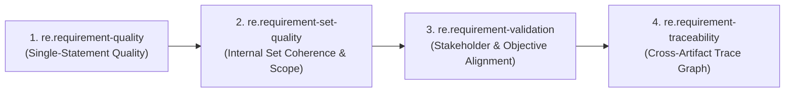

# Domain: Requirement Engineering (`re`)

The **Requirement Engineering (`re`)** domain provides generic, multi-language, and multi-artifact evaluation capabilities for assessing software and systems requirements across four complementary, strictly non-overlapping dimensions.

---

## 1. Implemented Core Skills (`status: draft`, `v0.1.0`)

| Skill ID | Path | Unit of Analysis | Primary Responsibility | Criteria & Rules |
|---|---|---|---|---|
| [`re.requirement-quality`](file:///c:/Users/Owner/Downloads/Skill_Review/skills/requirement-engineering/requirement-quality/SKILL.md) | `requirement-engineering/requirement-quality` | Single requirement statement ($r_i$) | Evaluates the 9 ISO/IEC/IEEE 29148 Clause 5.2.5 characteristics of an individual requirement (Necessary, Appropriate, Unambiguous, Complete, Singular, Feasible, Verifiable, Correct, Conforming). | `RQ-01` .. `RQ-09` (`RQ-R001` .. `RQ-R016`) + Language Packs (`en`, `vi`) |
| [`re.requirement-set-quality`](file:///c:/Users/Owner/Downloads/Skill_Review/skills/requirement-engineering/requirement-set-quality/SKILL.md) | `requirement-engineering/requirement-set-quality` | Requirement collection ($R = \{r_1, \dots, r_n\}$) & declared scope | Evaluates the ISO/IEC/IEEE 29148 Clause 5.2.6 characteristics of a requirement set: Scope Coverage, Set Completeness & Companion Coverage, Internal Consistency, Uniqueness/Duplication, Intra-Set Dependencies, and Set Organization/Classification. | `RSQ-01` .. `RSQ-06` (`RSQ-R001` .. `RSQ-R010`) |
| [`re.requirement-validation`](file:///c:/Users/Owner/Downloads/Skill_Review/skills/requirement-engineering/requirement-validation/SKILL.md) | `requirement-engineering/requirement-validation` | Requirements ($R$) $\leftrightarrow$ Stakeholder Needs / Objectives / Policies / ConOps ($N, O, P, C$) | Evaluates ISO/IEC/IEEE 29148 Clause 6.4 validation: Need Coverage, Stakeholder Intent Preservation, Business/System Objective Alignment, Authoritative Policy Compliance, Gold-Plating Prevention, and Operational Scenario Validity. | `RVAL-01` .. `RVAL-06` (`RVAL-R001` .. `RVAL-R010`) |
| [`re.requirement-traceability`](file:///c:/Users/Owner/Downloads/Skill_Review/skills/requirement-engineering/requirement-traceability/SKILL.md) | `requirement-engineering/requirement-traceability` | Traceability graph ($L \subseteq A_{up} \times R \times A_{down}$) | Evaluates ISO/IEC/IEEE 29148 Clause 6.5 traceability across lifecycle artifacts: Backward Coverage, Forward Coverage, Bidirectional Symmetry, Reference/ID Integrity, Link Relevance & Verification Compatibility, and Cross-Layer Orphans. | `RTR-01` .. `RTR-06` (`RTR-R001` .. `RTR-R010`) |

*(Additional format-specialized skills in `SKILL_REGISTRY.yaml` — `re.srs-review`, `re.use-case-analysis`, `re.acceptance-criteria` — remain `planned`.)*

---

## 2. Requirement Engineering Domain Ownership Matrix

To prevent duplicate findings across agents and skills, every review concern has **one and only one Primary Owner**:

| Review Concern | Primary Owner | Criterion / Rule | Explicitly Excluded From |
|---|---|---|---|
| **Single-Requirement Wording & Structure:** Lexical ambiguity, vague adjectives, compound sentences, missing actor/action/target, inline `TBD`, untestable single statement, premature design inside one statement | `re.requirement-quality` | `RQ-01` .. `RQ-09` | `re.requirement-set-quality`, `re.requirement-validation`, `re.requirement-traceability` |
| **Scope Coverage:** Declared in-scope feature, actor role, or external interface in the Scope section has 0 requirements in the set | `re.requirement-set-quality` | `RSQ-01` (`RSQ-R001`) | `re.requirement-validation`, `re.requirement-traceability` |
| **Companion & Lifecycle Set Completeness:** State entered with no exit transition (e.g., `LOCKED` with no unlock/expiry rule), mutating workflow with no failure/rejection rule, or whole section deferred as `TBD` | `re.requirement-set-quality` | `RSQ-02` (`RSQ-R002`, `RSQ-R003`) | `re.requirement-quality` |
| **Internal Set Consistency:** Contradictory behavior, permissions, numeric thresholds, timing bounds, units, or terminology drift between $r_i$ and $r_j$ inside the requirement set | `re.requirement-set-quality` | `RSQ-03` (`RSQ-R004` .. `RSQ-R006`) | `re.requirement-quality`, `re.requirement-validation` |
| **Duplicate & Overlapping Requirements:** Verbatim duplicates, paraphrased semantic duplicates, or divergent partial restatements across sections | `re.requirement-set-quality` | `RSQ-04` (`RSQ-R007`, `RSQ-R008`) | `re.requirement-quality` |
| **Intra-Set Horizontal Dependencies:** Broken internal cross-reference (`per REQ-99`), missing producer capability, or circular precondition deadlock ($r_i \leftrightarrow r_j$) | `re.requirement-set-quality` | `RSQ-05` (`RSQ-R009`) | `re.requirement-traceability` |
| **Set Organization & Classification:** Global NFRs buried inside a functional feature section, extreme peer granularity mixing, or ungrouped items | `re.requirement-set-quality` | `RSQ-06` (`RSQ-R010`) | `re.requirement-quality`, `re.requirement-traceability` |
| **Need Coverage:** Identified Stakeholder Need in BRD/Vision is omitted or only partially/superficially addressed by the requirement set | `re.requirement-validation` | `RVAL-01` (`RVAL-R001`, `RVAL-R002`) | `re.requirement-set-quality`, `re.requirement-traceability` |
| **Stakeholder Intent Alignment:** Requirement distorts stakeholder outcome (e.g., manual ticket instead of self-service), silently narrows scope, or inverts stakeholder priority | `re.requirement-validation` | `RVAL-02` (`RVAL-R003`, `RVAL-R004`) | `re.requirement-set-quality`, `re.requirement-traceability` |
| **Business / System Objective Alignment:** Requirement workflow/threshold undermines declared business KPIs, or a business objective has 0 operationalizing requirements | `re.requirement-validation` | `RVAL-03` (`RVAL-R005`, `RVAL-R006`) | `re.requirement-traceability` |
| **Authoritative Policy & Business Rule Compliance:** Requirement violates corporate policy, business rule, or regulatory mandate (e.g., segregation of duties, retention period) | `re.requirement-validation` | `RVAL-04` (`RVAL-R007`) | `re.requirement-set-quality` |
| **Unjustified Requirements (Gold-Plating):** Requirement introduces an unrequested feature with no basis in stakeholder needs, business objectives, policies, or system enablement | `re.requirement-validation` | `RVAL-05` (`RVAL-R008`) | `re.requirement-traceability` |
| **Operational Concept (ConOps) Validity:** Requirement conflicts with real-world operating environment (e.g., offline field work) or lacks business-outcome acceptance criteria | `re.requirement-validation` | `RVAL-06` (`RVAL-R009`, `RVAL-R010`) | `re.requirement-quality` |
| **Link Coverage (Backward & Forward):** Missing explicit trace link to origin (`NEED`/`OBJ`/`SYS-REQ`) or to downstream (`CHILD-REQ`/`UC`/`DESIGN`/`TEST`) | `re.requirement-traceability` | `RTR-01`, `RTR-02` (`RTR-R001` .. `RTR-R003`) | `re.requirement-validation`, `re.requirement-set-quality` |
| **Bidirectional Link Symmetry:** Forward link $(u \to d)$ and backward link $(d \to u)$ disagree across tables/artifacts | `re.requirement-traceability` | `RTR-03` (`RTR-R004`) | `re.requirement-set-quality` |
| **Reference & Identifier Integrity:** Trace link points to non-existent ID, `Deprecated`/`Deleted` item, or duplicate ID collision | `re.requirement-traceability` | `RTR-04` (`RTR-R005` .. `RTR-R007`) | `re.requirement-quality` |
| **Link Relevance & Verification Compatibility:** Bogus copy-pasted trace link between unrelated topics, or mismatch between verification method and linked verification item | `re.requirement-traceability` | `RTR-05` (`RTR-R008`, `RTR-R009`) | `re.requirement-validation` |
| **Cross-Layer Orphans & Unallocated Downstream Items:** Requirement omitted from RTM, or Test Case / Design Component with no parent requirement link | `re.requirement-traceability` | `RTR-06` (`RTR-R010`) | `re.requirement-set-quality` |

---

## 3. Recommended Execution Order & Optional Handoffs

All four skills declare `depends_on: []` in their manifests so that the Orchestrator can invoke any subset of them independently depending on the user's review scope and available artifacts. When a full Requirement Engineering review is requested, the recommended execution order is:

- **Handoff 1 (`RQ` $\to$ `RSQ`, `RVAL`):** If `re.requirement-quality` flags a requirement $r_i$ as severely ambiguous (`RQ-03`) or incomplete (`RQ-04`), downstream set-consistency (`RSQ-03`) and validation (`RVAL-02`) evaluations consume that context to adjust confidence rather than guessing $r_i$'s meaning.
- **Handoff 2 (`RTR` $\leftrightarrow$ `RVAL`):** `re.requirement-traceability` verifies whether structural links (`NEED-01` $\leftrightarrow$ `REQ-01`) exist and are valid (`RTR-01`..`RTR-06`), while `re.requirement-validation` verifies whether `REQ-01` semantically satisfies `NEED-01` (`RVAL-01`..`RVAL-02`).

---

## 4. Strict Lifecycle Non-Goals

This domain is strictly an **assessment and review** capability. It does **NOT** execute or manage Requirement Baselines, Requirement Version Control, Change Request Workflows, Requirement Sign-off/Approval Workflows, or Operational Change Management.
